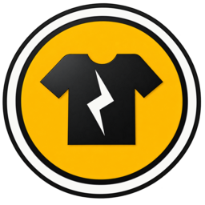

<p align="center"></p>

# Instagarment Print on Demand

A Shopify app for **Instagarment's customers**: brands whose shirts Instagarment prints.

- **Your customer** installs "Instagarment Print on Demand" on their Shopify store and picks which of their products Instagarment prints.
- **When one of their shoppers orders one of those products**, Instagarment immediately gets an email with the design, size and colour, quantity, SKU, personalisation, and order note.
- **Instagarment** works from one print queue that covers every customer's store. Tick items off as they're printed. The customer can see each order's status ("In production" or "Printed") inside their own Shopify admin.

### What each side sees

| | Where | What's there |
|---|---|---|
| **Your customers** | Shopify admin → Apps → Instagarment Print on Demand | Your logo; their chosen products, with **Add products** and **Remove** buttons; recent orders and their print status |
| **Instagarment** | `https://<your-app>/admin` (password protected) | **To print**: every store's open print jobs<br>**Pick list**: totals per design and size, for batch printing<br>**Printed**<br>**Stores**: who has installed the app<br>**Setup**: checklist and keys |

Orders are tagged in the customer's store (`instagarment-to-print` → `instagarment-printed`), so they can filter their Orders page by print status as well.

---

# Setting it up on Render: step by step

Plan on about an hour the first time. Here's the order, because each step needs something from the one before:

1. Create the Shopify app → you get a **Client ID and secret**
2. Put the code on Render → you get a **web address**
3. Fill in Render's settings
4. Give Shopify the app's **public key**
5. Send Shopify the **app settings file**
6. Turn on access to order data
7. Install the app on a test store and place an order
8. Submit the app to Shopify so real customers can install it

## What you need first

- A **GitHub** account. This code is already in the repo `instagarment/fictional-potato`.
- A **Render** account ([render.com](https://render.com)). Sign up with your GitHub account, which makes connecting the repo easy.
- A **Shopify Partner** account ([partners.shopify.com](https://partners.shopify.com), free). Shopify only lets apps owned by a Partner account be installed by other businesses' stores.
- An email account that can send mail by SMTP. Gmail is easiest. See step 3.

## Step 1: Create the app in Shopify

1. Log in to the **[Shopify Dev Dashboard](https://dev.shopify.com/dashboard/)** with your Partner account. Make sure your Partner organization is selected, not a store.
2. Click **Apps → Create app**. Name it **Instagarment Print on Demand**.
3. Open the app's **Settings** page:
   - Under **Credentials**, copy the **Client ID** and **Client secret** and keep them handy. Treat the secret like a password.
   - If there's an app icon option, upload `public/app-icon-1200.jpg` from this repo. It's your logo at the 1200×1200 size Shopify wants.

Leave the rest for now.

## Step 2: Put the app on Render

1. In Render, click **New → Blueprint**.
2. Connect GitHub if Render asks, then pick the repo **instagarment/fictional-potato** and the branch you want to deploy.
3. Render reads the `render.yaml` file in this repo and shows a service called **instagarment-pod** with a 1 GB disk. Click **Apply**.

It will ask you to fill in some values. You can fill these in now or later in step 3:

| Setting | What to put |
|---|---|
| `SHOPIFY_CLIENT_ID` | From step 1 |
| `SHOPIFY_CLIENT_SECRET` | From step 1 |
| `APP_URL` | Leave blank for now. You'll get the address once it's deployed. |
| `ALERT_EMAIL_TO` | Where alerts go, for example `orders@instagarment.com`. Separate several addresses with commas. |
| `SMTP_USER` | The email address that sends the alerts |
| `SMTP_PASS` | That account's app password (see step 3) |

**Cost:** the blueprint uses Render's **Starter** plan (about $7 a month) plus a 1 GB disk (a few cents a month). The free plan can't have a disk, and it goes to sleep when idle, which would delay alerts.

The first deploy takes a few minutes. When it's done, the top of the service page shows your address, something like `https://instagarment-pod.onrender.com`. **Copy it.**

## Step 3: Fill in Render's settings

In Render, open **instagarment-pod → Environment**:

1. Set **`APP_URL`** to the address you just copied. Use `https://` and leave off the trailing slash.
2. Check that `SHOPIFY_CLIENT_ID`, `SHOPIFY_CLIENT_SECRET`, `ALERT_EMAIL_TO`, `SMTP_USER` and `SMTP_PASS` are filled in.
3. **`ADMIN_PASSWORD`**: Render made a random one. Click the eye icon to see it, or replace it with your own. This is your print queue password.
4. Click **Save, rebuild, and deploy**.

**Gmail app password** (for `SMTP_PASS`):

1. Turn on 2-step verification for the Google account that will send the alerts.
2. Go to **Google Account → Security → App passwords** and create one called "Instagarment".
3. Paste the 16-character password into `SMTP_PASS`.

The defaults already set `SMTP_HOST=smtp.gmail.com`, `SMTP_PORT=465` and `SMTP_SECURE=true`. If you use another provider, such as Outlook, Zoho or Google Workspace, change those three to your provider's SMTP settings.

**Check it works:** open `https://<your-app>/admin/setup`. Log in with any username and your `ADMIN_PASSWORD`. Click **Send a test email**; the alert should arrive within a minute.

## Step 4: Give Shopify the app's public key

The first time the app starts, it creates its own security key and saves it on the Render disk. Shopify needs the **public** half of that key, so it can trust the app when the app asks for access to your customers' stores.

1. On `https://<your-app>/admin/setup`, click in the **Public key** box. It selects everything; copy it.
2. In the Dev Dashboard, go to your app → **Settings → Credentials → Public keys → Add key**. Paste it and click **Add key**.

The public key is safe to copy. The private half never leaves your Render disk.

## Step 5: Send Shopify the app settings

This step tells Shopify the app's name, web address, permissions, and where to send new orders. It also sets up the privacy webhooks every app is required to have. Shopify only accepts these through its command-line tool, so you'll run it from Render's built-in terminal.

1. In Render, open **instagarment-pod → Shell**.
2. Run:
   ```bash
   npm run shopify-config
   ```
   This writes the settings file, `shopify.app.toml`, and prints it.
3. Then run:
   ```bash
   npx @shopify/cli@latest app deploy
   ```
   - It asks you to log in. Open the link it shows, log in with your Partner account, and confirm the code.
   - If it asks which app to use, pick **Instagarment Print on Demand**.
   - When it asks to **release a new version**, say **yes**.

To check: in the Dev Dashboard, your app's **Versions** page should now show a new active version.

If you ever change `APP_URL`, run these two commands again.

## Step 6: Turn on access to order data

Shopify treats orders as customer data, so the app has to ask permission to read them. Without this, new orders won't reach the app.

In the Dev Dashboard (or the Partner Dashboard's **API access** page for the app), find **Protected customer data**:

- Request **protected customer data**. Reason: *"Read orders that contain products Instagarment prints, so we can produce them."*
- Also request the **Name** and **Address** fields. Reason: *"Show who the order is for and where it ships, so we can label and ship the print."*
- Fill in the **data protection** questions. The app keeps no copies of orders or customer details. Its privacy policy is at `https://<your-app>/privacy`; edit it in `src/embedded.js` if you need to.

For testing on a development store, you can carry on as soon as you've saved this. For real customers' stores, it's checked as part of the app review in step 8.

## Step 7: Test it on a development store

1. In the Dev Dashboard, go to **Stores → Create store**. Make a free development store, for example "Instagarment Test".
2. Open your app → **Install app** → choose the development store → **Install**.
3. Shopify opens the app inside the store's admin. You should see your logo and **Connected to Instagarment**.
4. Click **Add products** and pick a T-shirt product.
5. In the dev store, place a test order for that product.
6. Within a few seconds:
   - an alert email arrives;
   - the order appears at `https://<your-app>/admin`, labelled with the store's name;
   - the order is tagged `instagarment-to-print` in the dev store.
7. Click **Printed ✓** on your print queue. In the dev store, the app page now shows the order as **Printed**.

If an order doesn't show up, look in Render → **Logs**.

## Step 8: Let your customers install it

Until Shopify approves the app, it can only be installed on development stores. To make it installable on your customers' real stores:

1. In the Dev Dashboard, open your app's **Distribution** card and choose **Public distribution**. You can't change this later.
2. Create the **Shopify App Store listing**. Shopify charges a one-time developer registration fee the first time. In the listing:
   - **Name:** Instagarment Print on Demand
   - **Icon:** `public/app-icon-1200.jpg`
   - **Privacy policy URL:** `https://<your-app>/privacy`
   - Screenshots of the app page your customers see
3. Submit it for review. Shopify reviews apps in roughly a few weeks, and its reviewers may email you questions.
4. After approval, you can set the listing to **unlisted** if you don't want strangers finding it. Your customers then install it from the direct link to your listing.

---

## Everyday use

- **New customer?** Send them the install link. Once they've installed it and picked their products, they show up on the **Stores** tab.
- **Missed something?** Use **Scan** on the To print page. It checks every store's open orders from the last 7, 30 or 60 days. Every 15 minutes the app also checks the last day of orders automatically, in case a notification from Shopify got lost.
- **Customer uninstalls?** They drop off the queue automatically. Shopify asks the app to forget the store 48 hours later, and it does.

## Running it on your own computer (optional)

```bash
cp .env.example .env    # fill it in
npm install
npm start               # http://localhost:3000/admin
npm test                # automated tests, no Shopify needed
```

## How it works (for developers)

```
Customer's store ──orders/create webhook──▶ POST /webhooks  (signature checked)
                                              │ get an app-only token for that store (signed client assertion)
                                              │ load the order + product tags
                                              ▼
                               any products tagged "instagarment"?
                                 └ yes → tag order instagarment-to-print → email Instagarment
Instagarment /admin ◀── query every installed store for tagged orders (combined queue)
Customer's Shopify admin → /app (App Bridge, ID-token auth) → pick products, see status
```

- **Store access:** Shopify's *application-only access tokens*. The server signs a short-lived JWT with its private key, so it can reach any store that installed the app without storing or refreshing tokens. The key is created on first boot in `DATA_DIR`. To bring your own, set `SHOPIFY_KEY_ID` plus `SHOPIFY_PRIVATE_KEY` or `SHOPIFY_PRIVATE_KEY_PATH`.
- **State:** print status lives on each order in the customer's store (tags plus the `instagarment.printed` metafield). The server keeps only `shops.json` (the list of stores) and the signing key.
- **Webhooks:** `orders/create`, `app/uninstalled`, and the mandatory compliance topics, all sent to `POST /webhooks`. They're declared in `shopify.app.toml`, which is generated by `src/shopify-toml.js`.

| File | What it does |
|---|---|
| `src/server.js` | Routes: webhooks, the customer-facing page and API, Instagarment admin |
| `src/tracker.js` | Which items to print, tagging, the combined queue, scanning |
| `src/shopify.js` | Store access (client assertion), webhook and ID-token checks |
| `src/embedded.js` | The page your customers see inside Shopify, and the privacy policy |
| `src/views.js` | Instagarment's admin pages |
| `src/email.js` | The alert email |
| `src/shops.js` / `src/keys.js` | List of installed stores / signing key, both on the disk |
